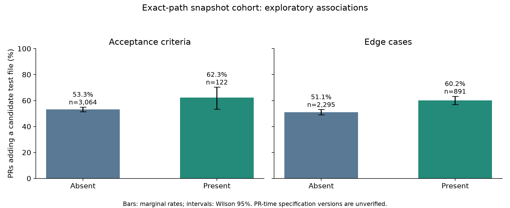

# CS 520 RQ1: preliminary research summary

Prepared November 2, 2026 for the November 5 midpoint. Final project due December 15, 2026.

**Finding:** snapshot specifications with the studied features have higher marginal test-file addition rates in this selected sample. Evidence is sensitive to tool adjustment, change-size adjustment, the test detector, and the temporal subset. These results do not establish an association with the actual specification text present at PR creation, and do not support a causal claim.

## Data feasibility and analysis population

Used the locally cloned SpecMine v1.1 500-repository sample only. The four requested tables contain 28,583 specs, 28,583 feature rows, 5,335 PR records, and 288,267 tool-level changed-file records. Deduplication gives 5,322 PRs in 229 repositories and 287,117 PR/file observations. Thirteen extra PR records are repeated tool discoveries.

The snapshot contains 25,481 distinct repository/path pairs; 17 paths have conflicting content or feature snapshots. Exact unambiguous paths link at least one spec to 5,281 PRs. Requiring complete active-spec feature coverage, complete file lists, and at least one non-test source change leaves **3,186 PRs in 215 repositories**. This is the main exploratory snapshot cohort, not a version-verified historical cohort.

| Sequential inclusion stage | PRs | Repositories |
|---|---:|---:|
| unique prs | 5,322 | 229 |
| complete file lists | 5,306 | 229 |
| active spec | 5,304 | 228 |
| complete exact spec features | 4,074 | 224 |
| non test source change | 3,186 | 215 |

Complete file lists require files_status=done, observed unique path count equal to n_files, fewer than 3,000 files, and no conflicting global PR or file metadata. Removed specs are retained in the link audit but cannot supply active predictors. Renamed files are retained without inferring their previous paths. The exclusion ledger records all overlapping reasons for every excluded PR.

## Measures and statistical methods

A PR is identified by repository and PR number. All discovery tools are retained as a sorted list; multi-tool PRs count once. Specs join to precomputed features one-to-one on file_url_sha16, then to PR files on exact repository/full path after collapsing identical-content, identical-feature snapshot duplicates. No basename matching, archive-prefix removal, repository-only linkage, or inferred rename matching is used.

For multiple active specs, a binary feature is present if any spec has it, and word count is the sum across distinct matched paths. All active specs must have complete, unambiguous primary features; missing features are never coded as absence. Acceptance criteria and edge cases enter models separately. The existing labels are structural/template signals rather than independently validated measures of requirement quality.

The secondary testing-directive classifier requires an English imperative/modal and a phrase such as unit tests, integration tests, or automated tests on the same line within 100 characters. It ignores fenced code, HTML comments, and lines with explicit negation/optional wording. It can miss multilingual, indirect, multi-line, or differently phrased requirements. Raw text hashes were checked against the supplied SHA-256 values before classification.

The path detector recognizes cross-language test names and executable files in test directories, excludes documentation, samples/fixtures/mocks, generated/vendor files, and specification tooling, and flags uncertain cases. The primary outcome is at least one candidate test file with status added. Modified, removed, and renamed tests remain separate. Additions and modifications can both occur in one PR. New test cases inside an existing file, inline Rust tests, and test execution/passing are not observable from file paths.

Source-change count uses recognized executable-source extensions outside spec directories, excluding identified tests, fixture/sample files, and generated/vendor files. It is distinct from the supplied is_code flag. Repository stars, primary language, size, and licenses are snapshot metadata; a deterministic latest content-fetch row supplies them, and metadata variation is logged. They are not PR-time measurements.

Reported marginal group intervals are Wilson 95% intervals. Two-sided chi-square tests are used when expected counts are at least five, otherwise Fisher exact tests. Conditional odds ratios have exact 95% intervals; risk ratios have log-scale approximate intervals when all cells are positive. Independence-based p-values and intervals are descriptive because PRs cluster by repository. Holm adjustment is supplied for the two primary addition comparisons. Repository bootstrap intervals for risk differences use 2,000 whole-repository resamples with seed 520.

Logistic models include both primary predictors, has_requirements when variable, log(1+total spec words), log(1+stars), grouped primary programming language, and optionally log(1+changed source files) and tool. Languages with at least 50 observations are retained up to the five largest; tools with at least 20 observations are retained; other categories are pooled. Standard errors cluster by repository with a finite-sample correction. Fits are withheld for fewer than 30 clusters, fewer than ten events/non-events per parameter, rank deficiency, separation, or unstable estimates. Source-change count is measured in the same PR and could be a mediator or collider; the model omitting it is a sensitivity check. These model choices were made during exploratory analysis, not preregistered.

## Descriptive results

Candidate test files were added in 1,708/3,186 PRs (53.6%) and modified in 1,936 (60.8%). Acceptance criteria appear in 122 PRs (3.8%), edge cases in 891 (28.0%), requirements in 3003 (94.3%), and testing directives in 323 (10.1%). Primary feature columns have no missing values after complete-coverage selection; frequencies and missingness before selection are also exported.

| Snapshot feature | Absent: additions / PRs | Present: additions / PRs | Rate difference (repository-bootstrap 95% CI), percentage points |
|---|---:|---:|---:|
| Acceptance criteria | 1632/3064 (53.3%) | 76/122 (62.3%) | 9.0 (-8.4, 22.4) |
| Edge cases | 1172/2295 (51.1%) | 536/891 (60.2%) | 9.1 (0.8, 18.1) |
| Testing directive (secondary) | 1498/2863 (52.3%) | 210/323 (65.0%) | 12.7 (3.9, 22.8) |

## Adjusted associations and sensitivity

Main model below adjusts for tool, language, requirements, word count, stars, and source-file change count, with repository-clustered intervals. Odds ratios describe odds, not probability ratios.

| Outcome | Predictor | Adjusted odds ratio (95% CI) | p-value |
|---|---|---:|---:|
| test added | Acceptance criteria | 1.55 (0.74, 3.24) | 0.248 |
| test added | Edge cases | 1.57 (0.98, 2.50) | 0.058 |
| test modified | Acceptance criteria | 1.34 (0.62, 2.93) | 0.457 |
| test modified | Edge cases | 1.01 (0.64, 1.60) | 0.955 |

All unadjusted contingency tests, effect sizes, adjusted models (including the secondary testing-directive model), and diagnostics are saved in outputs/tables/. Main intervals should be interpreted together with the following sensitivity checks, not as a definitive yes/no answer.

| Addition-rate sensitivity | Acceptance criteria: difference, pp (95% cluster CI) | Edge cases: difference, pp (95% cluster CI) |
|---|---:|---:|
| high confidence detector | 9.7 (-7.6, 23.4) | 7.6 (-1.0, 16.8) |
| temporal overlap | 5.5 (-14.6, 23.5) | 9.4 (-0.5, 19.8) |
| without largest repository | 9.1 (-7.9, 22.5) | 9.3 (0.2, 18.6) |

The edge-case modification contrast has a different marginal direction from the addition contrast; tool adjustment can substantially change it. The source-unadjusted model also changes the addition estimates. These differences make template composition and analysis choices material to the conclusion.

| Tool attribution | PRs | Acceptance prevalence | Edge-case prevalence |
|---|---:|---:|---:|
| openspec | 1915 | 0.8% | 1.1% |
| speckit | 1155 | 4.4% | 74.5% |
| moai | 48 | 47.9% | 6.2% |
| conductor | 32 | 90.6% | 12.5% |
| claude_code | 16 | 0.0% | 0.0% |
| codex | 11 | 0.0% | 0.0% |
| agent_os | 3 | 66.7% | 33.3% |
| multiple | 3 | 0.0% | 33.3% |
| trae | 3 | 33.3% | 0.0% |

Within-tool exposure counts and testing rates are exported separately. Large template differences and limited overlap can leave residual confounding even after grouped tool adjustment. Tool labels do not prove that any AI agent wrote the implementation.

## Validation and threats to validity

- **Temporal validity:** 1,085 retained PRs have at least one spec whose snapshot last-change date is after the PR ended; 696 have a last-change date before PR creation (these categories can overlap across specs). Only 1,521 have all last-change dates inside the interval. History-commit counts are exported as plausibility diagnostics. None proves that a commit belonged to the PR, that file contents match its head, or that features existed before implementation. **Zero PR-time content versions are verified.**
- **Linkage validity:** full exact paths prevent speculative matches but exclude moved/deleted specs and PRs with partial feature coverage. Identical basenames and analogous change/archive paths are not enough. The CSV ledger and full link Parquet preserve excluded observations and unmatched paths. Included-versus-excluded testing rates reveal selection from matching requirements.
- **Detector validity:** manually inspected 60 file paths (30 predicted tests and 30 predicted non-tests). 44 received determinate path labels, with 44 agreements and 0 disagreements; 16 require content inspection. This was an unblinded assistant path review, not independent human annotation. No contents, assertions, or test runs were checked, so population precision and recall are not established. Directory-only support modules and shell harnesses can be false positives; tests under examples/spec tooling, unusual filenames/extensions, and inline tests can be false negatives. The explicit-filename sensitivity excludes detector-flagged uncertain positives but cannot resolve all errors.
- **Targeted false-negative audit:** separately inspected 25 test-looking paths originally predicted negative. Six received test path labels: Rust tests.rs and *_tests.rs, C# .unittests.cs, and explicitly named Python/Go tests inside example packages. Rules were corrected for those conventions; explicitly named tests inside examples remain detector-flagged uncertain. The corrected detector agrees with all determinate targeted labels, while 3 cases remain unresolved. Total unique paths reviewed: 85; unresolved across both audits: 19. These are path-level judgments, not content-verified error rates.
- **is_code validity:** 1,425 candidate test-file observations have is_code=0, demonstrating why that flag was not used as a prefilter.
- **Sampling and dependence:** the 500 repositories were selected for PR richness, tool coverage, and stars; the PR sweep targeted repositories with at least ten stars. These are conditional sample rates, not corpus-wide estimates. PRs are dependent within repositories; bootstrap/clustered inference helps but does not remove selection bias or repository-level confounding. Exposure-specific repository counts and largest-repository sensitivity are exported.
- **Outcome scope:** a candidate added file is neither a count of new assertions nor evidence of execution, adequacy, passing tests, or improved software quality. A modification can add tests, remove assertions, or refactor helpers. Existing tests untouched by a PR are unobserved. Same-PR co-occurrence cannot establish direction or causation.
- **Privacy and licensing:** exports omit author fields, avatars, and raw prose. The actual spec schema contains five avatar URL columns beyond the documented 124; none is loaded into research observations. Source files remain unchanged, verified with SHA-256. Dataset citation and source repository license terms apply; this project does not relicense underlying artifacts.

## Implications and next steps

The midpoint milestone is met: local data loaded, schema and keys audited, exact-path linkage established, detector implemented and path-audited, and descriptive/adjusted analyses executed. The defensible current result is an exploratory association involving snapshot labels, with substantial temporal and template limitations. Stronger evidence requires pinned PR-head (and ideally pre-implementation) spec contents, historical paths/blob hashes, re-extracted features, and independent content-level detector annotation. Expanding to the full dataset alone would not fix those validity problems.

Before December 15, prioritize those validation improvements and a carefully bounded write-up over a larger unverified join. Preserve this frozen sample analysis as the reproducible midpoint baseline.

## Sources

- [SpecMine official sample and documentation](https://github.com/shyamagarwal13/specmine-official)
- [Data dictionary](https://github.com/shyamagarwal13/specmine-official/blob/main/DATA_DICTIONARY.md)
- [Full dataset mirror (not downloaded)](https://huggingface.co/datasets/ShyAgarwal/specmine)
- Agarwal, Shyam and Vasilescu, Bogdan (2026), *SpecMine: A Large-Scale Corpus of Spec-Driven Development Artifacts*, [Zenodo DOI](https://doi.org/10.5281/zenodo.22102779).
